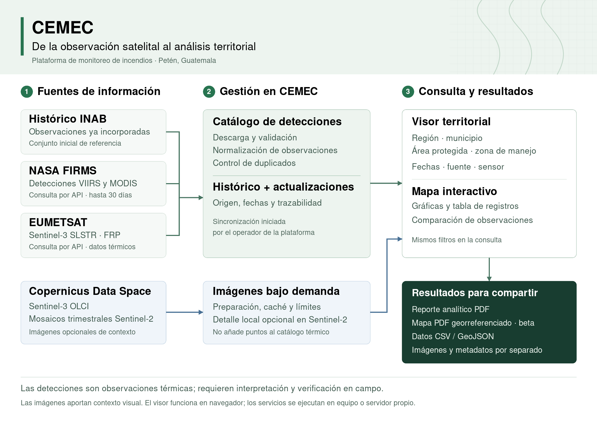
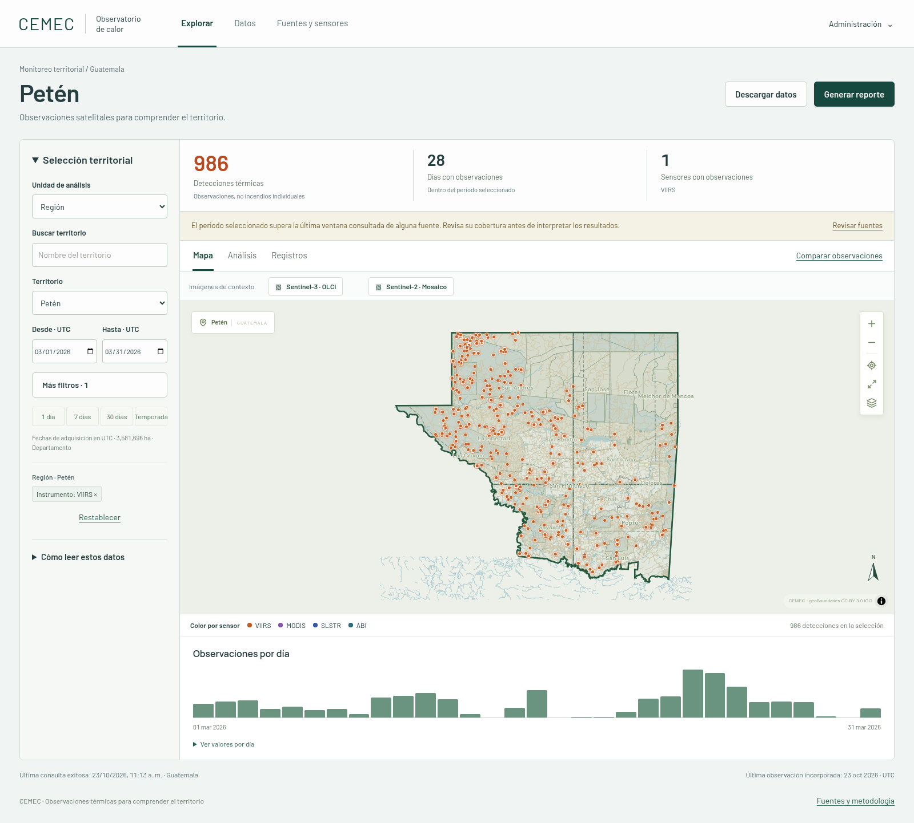

# CEMEC · Plataforma de monitoreo de incendios

Observatorio territorial para consultar detecciones térmicas, comparar sensores y generar reportes para Petén, Guatemala. Integra el histórico INAB y consultas manuales de NASA FIRMS y EUMETSAT, con imágenes de contexto opcionales de Copernicus.

[](docs/diagramas/cemec-plataforma-flujo.svg)

Las detecciones térmicas y las imágenes de contexto siguen rutas distintas. El catálogo conserva el histórico y las actualizaciones; el visor permite consultar por territorio y período, comparar observaciones y exportar resultados. [Ver explicación del flujo y archivos editables](docs/diagramas/README.md).



## Instalar una copia desde GitHub

Servidor validado en Ubuntu/Linux de 64 bits. Instala **Conda/Miniforge** y descarga o clona el repositorio completo. Desde su carpeta:

```bash
./Setup-CEMEC.sh
cp -n .env.example .env
PORT=8090 ./Start-CEMEC.sh
```

Abre **http://localhost:8090**. El instalador crea un entorno Conda dedicado `.conda-env` y verifica la compilación incluida. No necesita el ZIP de origen si el checkout está completo. Las claves se completan localmente en `.env`: FIRMS, EUMETSAT y CDSE según las funciones que se vayan a utilizar. Sin claves se puede consultar el conjunto inicial; las descargas de proveedores requieren las credenciales y permisos correspondientes.

La compilación incluye un conjunto inicial fijo de datos. Las sincronizaciones posteriores quedan en `runtime/`, fuera de Git. La consulta y el reporte pueden usarse desde navegadores Windows; una instalación del servidor en Windows nativo aún necesita las adaptaciones documentadas en los [manuales](docs/manuales/README.md).

## Alcance del repositorio

- Selección por región, municipio, área protegida y zona de manejo; filtros y comparación de observaciones.
- FIRMS hasta 30 días por tarea, dividido en bloques; Sentinel-3 SLSTR FRP vía EUMETSAT.
- Sentinel-3 OLCI y mosaicos trimestrales Sentinel-2 opcionales; detalle bajo demanda en Sentinel-2.
- Reportes PDF, mapa georreferenciado beta y descargas de datos.
- Código legible del backend y adaptadores, interfaz, pruebas, configuración, manuales y compilación original verificada.

La compilación original está disponible; el proyecto fuente original de React no fue entregado. La presentación se mantiene en `ui/` y se integra mediante `scripts/`. No se incluyen claves, originales ZIP, cachés, respaldos ni entregas privadas. Consulta [procedencia y licencias](NOTICE.md) y la [guía de preparación para GitHub](docs/github.md). La publicación del código no despliega la plataforma ni sustituye al servidor Python/Node por GitHub Pages.

## Desarrollo y pruebas

Con el entorno dedicado activado:

```bash
python scripts/replicate.py --verify-only
python -m unittest discover -s tests -p 'test_*.py'
python scripts/github_repository.py audit
```

Las pruebas Python usan proveedores simulados y no necesitan claves reales. El flujo de GitHub Actions realiza estas comprobaciones en Linux; consulta su resultado en la pestaña **Actions** del repositorio. Las pruebas visuales opcionales requieren herramientas adicionales; ver [CONTRIBUTING.md](CONTRIBUTING.md).

## Documentación y operación

El [diseño cartográfico del observatorio](docs/diseno/interfaz-cartografica-20261026.md)
está implementado: selección territorial lateral, mapa ampliado y controles
plegables en móvil. La interfaz anterior se conserva en un respaldo oculto.

La beta de [mapa PDF georreferenciado](docs/mapa-georreferenciado.md) se encuentra
en **Generar reporte → Mapa PDF georreferenciado · beta**. Exporta el mapa con
los filtros y capas visibles, además de ofrecer sus metadatos. El reporte
analítico habitual conserva su opción **Generar PDF**.

Consulta el [índice de documentación](docs/README.md) para operación,
recuperación, diseño, validaciones y política de retención de archivos.

El [diseño visual](docs/diseno/README.md) está implementado: filtros territoriales
principales, controles avanzados agrupados, fuentes/sensores, comparación y reportes
PDF con trazabilidad. La versión previa está respaldada; consulta
[cómo restaurarla](docs/diseno/interfaz-cartografica-20261026.md).

La [validación del diseño](docs/validacion-diseno.json) registra las pruebas de
interfaz, los reportes y la conservación de datos al desplegar en localhost.

Los [manuales completos de instalación y uso](docs/manuales/README.md) están
disponibles en PDF y Word. Distinguen acceso por navegador, preparación Windows nativa y WSL2 como alternativa.

## Nueva interfaz

La [política de retención](docs/retencion.md) está configurada en modo de
simulación. Ejecuta `.conda-env/bin/python scripts/retention.py` para ver los
candidatos; todavía no hay eliminación automática.

### Mapa de fondo opcional

En **Capas del mapa → Mapa de fondo**, elegir **Mapa CEMEC** o
**Esri · Imagen satelital**. CEMEC sigue siendo el predeterminado. Esri solo
solicita las teselas visibles cuando se selecciona; al desactivarlo se retira la
fuente. No se guarda una colección de imágenes en el servidor. La fecha del fondo
puede variar y no corresponde necesariamente a la de las detecciones.
Consulta [operación, consumo y configuración](docs/fondo-esri.md).

### Imágenes opcionales: Sentinel-3 OLCI y mosaicos Sentinel-2

En **Explorar → Mapa**, pulsa **Sentinel-3 · OLCI** o **Sentinel-2 · Mosaico**.
Solo una imagen de fondo permanece activa. OLCI conserva **Última disponible**
y **Elegir período**. Sentinel-2 ahora usa mosaicos trimestrales oficiales L3:
**Último publicado** o **Elegir trimestre**, con año y T1/T2/T3/T4.

La consulta se inicia al solicitarla. El mosaico se prepara una vez para el
rectángulo regional de Petén y se reutiliza entre municipios y otras unidades
contenidas en él. El zoom no produce solicitudes de procesamiento nuevas.
La vista regional se limita a 1024 píxeles por lado; no descarga más detalle al
acercarse. Para aumentar el detalle, acércate y pulsa **Cargar detalle de esta zona**.
El botón prepara solo el recorte visible; **Vista general** retira ese detalle.
La escala efectiva y el trimestre se muestran sobre el mapa. Consulta la
[guía de detalle bajo demanda](docs/detalle-mosaico.md).

La prueba real del 19 de octubre obtuvo abril–junio de 2026 como último publicado,
con 100 % del territorio con datos. Prepararlo consumió 3,58594 unidades de
procesamiento frente a 8,67310 de la anterior vista L2A de 1600 píxeles (58,7 %
menos en esta comparación). No es una comparación a igual resolución ni un
ahorro garantizado para cualquier petición. Cambiar de municipio reutilizó el
archivo y el zoom no inició otra preparación.

`config.yaml` controla `sentinel2.max_image_side`, `catalog_cache_hours: 24` y
`max_new_mosaics_per_day: 6`. Se guarda el catálogo y también las respuestas
vacías. Los aciertos de caché no consumen el presupuesto de preparaciones nuevas.
El registro de intentos y PU reportadas queda en `runtime/sentinel2/usage.json`.
No se ejecutan descargas periódicas automáticas. La retención sigue en simulación.

Los mosaicos combinan fechas del trimestre, reducen nubes y pueden conservar
huecos; no son imágenes de un día ni prueban ausencia de fuego. No añaden puntos
al catálogo térmico. Se avisa si el trimestre difiere del período de detecciones.
La imagen y sus metadatos se descargan por separado; el PDF térmico conserva sus
mapas de detecciones y límites.

Las credenciales CDSE permanecen en `.env`. OLCI usa `runtime/olci`; los mosaicos
usan `runtime/sentinel2`, que también conserva las composiciones L2A anteriores.
Consulta la [guía actual de mosaicos](docs/mosaicos-sentinel2.md),
[operación de OLCI](docs/olci-visor.md) y la
[versión anterior de Sentinel-2 RGB](docs/sentinel2-visor.md).

```bash
.conda-env/bin/python -m unittest discover -s tests -p 'test_*.py'
.conda-env/bin/node tests/check_olci_ui.cjs
.conda-env/bin/node tests/check_sentinel2_ui.cjs
.conda-env/bin/node tests/check_detail_ui.cjs
```

OLCI conserva su imagen general con resolución nominal de unos 300 m.
El detalle bajo demanda está disponible únicamente para Sentinel-2.

### Consulta de detecciones

**Explorar** permite elegir región, municipio, área protegida o zona de manejo,
buscar un territorio y definir fechas UTC. **Más filtros** conserva fuente,
instrumento, satélites, confianza, día/noche y color del mapa. Los criterios activos
se muestran en etiquetas que se pueden quitar. El inicio muestra los últimos
7 días UTC y todos los instrumentos; Temporada permite recuperar la consulta anual.

**Fuentes y sensores** explica procedencia, resolución nominal, calidad y
limitaciones, con estado de consulta por proveedor. **Comparar observaciones**
mantiene territorio, fechas y filtros; permite elegir dos combinaciones de fuente
y sensor, mostrar mapas y series separadas y generar su reporte. Cero registros no
certifica cobertura completa ni ausencia de fuego.

**Generar reporte → Generar PDF** usa la selección actual. Incluye mapa, evolución,
resultados por fuente/instrumento/versión, consultas y metodología. El reporte de
comparación restringe los registros a las dos selecciones y conserva sus nombres.
**Descargar datos** ofrece CSV y GeoJSON; Datos contiene los archivos completos y
GeoParquet por fecha. Administración reúne Ajustes, importación y mapas/lotes.
Separar este menú no añade autenticación de usuarios; el despliegue sigue siendo local.

La interfaz se adapta a móvil y tiene controles con etiquetas, diálogos nativos
que admiten Escape, foco visible y tablas de valores para las gráficas. Los PDF
precálculados originales siguen disponibles desde las opciones heredadas y no se
regeneran por el rediseño.

Los archivos nuevos se encuentran en `ui/`. Los adaptadores en `scripts/redesign.cjs`
y `scripts/report_patch.cjs` reutilizan el motor cartográfico y exportador original
sin modificar sus archivos en disco. Una compilación original distinta requeriría
adaptar y validar esos puntos de integración.

Para comparar temporalmente con la interfaz anterior, sin restaurar datos:

```bash
CEMEC_LEGACY_UI=1 PORT=8091 ./Start-CEMEC.sh
```

También se puede elegir `interface.layout: legacy` en `config.yaml` y reiniciar.
El modo anterior conserva las conexiones API añadidas. La recuperación completa
del estado respaldado se describe en `respaldos/RESTAURAR.md`.

Prueba integral aislada del nuevo diseño (requiere Chrome y la caché Playwright
descrita al final de este documento):

```bash
.conda-env/bin/node tests/check_redesign_ui.cjs
```

Réplica de la compilación entregada en `origen/cemec-sitio-estatico.zip`. Los 1.127 archivos
del visor permanecen idénticos al ZIP, incluida la interfaz React, MapLibre GL,
PMTiles, datos y productos. La adaptación añade un servidor, lanzadores locales
y un backend de sincronización con NASA FIRMS y EUMETSAT / Sentinel-3.

## Iniciar

Desde esta carpeta:

```bash
./Start-CEMEC.sh
```

Abrir **http://localhost:8000**. Detener con **Ctrl+C**. Para abrir el navegador
automáticamente, usar `./Start-CEMEC.sh --open-browser`.

El entorno está en `.conda-env`, dentro del proyecto. Para activarlo manualmente:

```bash
conda activate ./.conda-env
```

El lanzador usa ese entorno directamente; no necesita activación previa.
Python 3.12 y PyYAML leen y verifican la configuración; Node.js 22 sirve la web con
módulos nativos. Shapely asigna territorios y PyArrow genera GeoParquet.
Las librerías del frontend ya están compiladas en `assets/`:
no se necesita `npm install` ni instalar dependencias en Conda base.

## Instalar en otra computadora

Copiar la carpeta `origen/` con el ZIP y el documento originales, `environment.yml`, `config.yaml`, `serve.js`,
los dos scripts `.sh`, `scripts/`, `tests/` y `docs/`. La carpeta extraída del
sitio es opcional: el instalador la reconstruye del ZIP. No copiar `.conda-env`
ni `.conda-pkgs`, porque los entornos contienen rutas específicas de instalación.
Se requiere Conda instalado y conexión a conda-forge durante la instalación.

```bash
chmod +x Setup-CEMEC.sh Start-CEMEC.sh
./Setup-CEMEC.sh
./Start-CEMEC.sh
```

`environment.yml` define las dependencias portables. `environment-linux-64.lock.txt`
registra las versiones, builds y SHA-256 de los paquetes instalados. Para reproducirlos en otra
máquina **Linux x86_64**, copiar también el lock y usar:

```bash
CONDA_PKGS_DIRS="$PWD/.conda-pkgs" conda create --prefix "$PWD/.conda-env" --file environment-linux-64.lock.txt --yes
./Setup-CEMEC.sh
```

En otro sistema o arquitectura, resolver `environment.yml` de nuevo; el lock
Linux no es compatible. Los scripts `.sh` están destinados a Linux.

## Configuración y trazabilidad

`config.yaml` documenta rutas relativas, servidor, hashes de los insumos,
versiones del conjunto de datos y requisitos para replicar el despliegue.
`scripts/start.py` consume la sección `server` y activa el backend configurado en
`firms`. Las secciones de insumos y datos describen la copia original verificable.

```bash
# Puerto alternativo
PORT=8080 ./Start-CEMEC.sh

# Compartir en la red local; acceder desde otra computadora por la IP de este equipo
HOST=0.0.0.0 ./Start-CEMEC.sh

# Verificar SHA-256, copia original y referencias de catálogos
.conda-env/bin/python scripts/replicate.py --verify-only

# Pruebas HTTP, incluidos los rangos usados por PMTiles
.conda-env/bin/python -m unittest discover -s tests -v
```

Por defecto escucha en `127.0.0.1`. También se puede cambiar `host` y `port`
en `config.yaml`. No abrir `index.html` directamente: se requiere HTTP, y los
archivos PMTiles necesitan respuestas `206 Partial Content`. El servidor sirve
el visor y los snapshots publicados, por lo que el ZIP, la configuración, la clave,
los CSV crudos y el entorno no se publican. Las rutas del visor requieren servirlo en `/`.

## Descargar y analizar datos de FIRMS

1. Solicitar una MAP_KEY gratuita en https://firms.modaps.eosdis.nasa.gov/api/map_key/.
2. Reiniciar la aplicación con `./Start-CEMEC.sh` si había un servidor anterior abierto.
3. Entrar en **Ajustes** e introducir la MAP_KEY en el campo de contraseña.
4. Elegir hasta 30 días y los productos VIIRS o MODIS; pulsar **Sincronizar ahora**. FIRMS se consulta en bloques de hasta 5 días por producto; el catálogo se publica al completar todos los bloques.
5. Esperar la confirmación. El visor recarga el catálogo y ajusta la fecha final al
   último dato publicado. Usar los filtros, Análisis y Registros para consultar
   y descargar las detecciones. El filtro **NASA FIRMS** distingue los nuevos datos
   de los registros históricos de INAB.

La clave introducida en la interfaz se utiliza solo para esa tarea. Como alternativa,
copiar `.env.example` a `.env`, completar `FIRMS_MAP_KEY=...` y reiniciar. `.env` se
excluye del control de versiones. También se puede exportar la variable
`FIRMS_MAP_KEY` antes de iniciar. No guardar la clave en `config.yaml`.

Las descargas se consultan para el rectángulo geográfico `firms.bbox`. Las geometrías
originales permiten asignar municipios, áreas protegidas y zonas de manejo.
La fuente NOAA-20, NOAA-21 o S-NPP determina el satélite VIIRS; MODIS identifica
Terra y Aqua. Las fechas y horas se conservan en UTC.

Después de sincronizar, el selector **Región** incluye **Área de consulta FIRMS**:
el rectángulo configurado, con todos los registros que caen dentro de él. Permite
analizar detecciones externas a los municipios y áreas protegidas originales.
Es una extensión de consulta, no una jurisdicción. Los puntos externos no se
asignan artificialmente a Petén; el área indicada del rectángulo es aproximada.

El backend valida coordenadas, fechas, horas, confianza y FRP. Identifica una detección
por coordenadas a seis decimales, fecha, hora, satélite e instrumento, con el mismo
hash del histórico. Si ya existe en INAB, conserva ese registro y su origen. Si ya
existe en FIRMS, puede actualizar sus atributos. Por tanto, el filtro FIRMS muestra
solo las detecciones con ese origen, no todas las detecciones devueltas por NASA.

Los CSV descargados se guardan en `runtime/firms/downloads/`; las tareas y sus
resultados en `runtime/firms/jobs/`; los snapshots en `runtime/firms/snapshots/`.
Cada resultado registra período, productos, extensión, conteos y SHA-256 de los CSV.
El catálogo activo cambia solo cuando todos los productos y archivos se procesaron
correctamente. Si una fuente falla, se conserva la versión anterior. Una descarga
sin detecciones no borra el histórico. La integración acumula datos y no elimina
automáticamente registros que NASA retire posteriormente.

Los snapshots nuevos incluyen JSON diarios, JSON mensuales por territorio,
estadísticas y GeoParquet. Los límites, PMTiles y productos PDF precalculados
originales conservan sus versiones. Para mapas y reportes de detecciones nuevas,
usar la generación en el navegador; los PDF precalculados no se regeneran.

El servidor aplica ajustes al JavaScript al entregarlo, sin editar el archivo
original: actualizar la fecha final tras sincronizar, conservar el mapa cuando solo
cambian las detecciones y delegar al backend solo las importaciones CSV/GeoJSON.
Shapefile ZIP conserva la importación local del navegador.
Importaciones al backend hasta 20 MB; GeoPackage y GeoParquet requieren conversión
previa a CSV o GeoJSON en esta implementación.

La actualización es manual desde el botón. No se añadió aún una programación
automática ni una sincronización nueva de INAB. Para consultar un período específico,
`POST /api/sync` también admite `start: YYYY-MM-DD` y `days: 1..5`; la disponibilidad
de fechas depende del producto FIRMS. Las pruebas automatizadas usan CSV simulados. Además, el 8 de octubre de 2026
se verificó una descarga autenticada real de FIRMS: 6 detecciones recibidas,
5 ya existentes y 1 incorporada. Una segunda consulta confirmó la deduplicación.

## Sincronizar EUMETSAT / Sentinel-3

Para diagnosticar y recuperar una actualización fallida, sigue la
[guía de recuperación de sincronización](docs/recuperacion-sincronizacion.md).
Incluye el procedimiento comprobado tras el HTTP 403, errores de autenticación,
consultas sin detecciones, reintentos y ubicación de los registros.

En **Ajustes → EUMETSAT · Sentinel-3**, selecciona el periodo y pulsa
**Sincronizar Sentinel-3**. El servidor consulta la colección `EO:EUM:DAT:0417`
para Sentinel-3A/B, descarga únicamente `FRP_MWIR1km_standard.csv` y procesa
todos los productos/páginas encontrados. No se aplica el límite de 12 del notebook
exploratorio. El área predeterminada es la misma usada para FIRMS; las detecciones
se recortan por coordenadas y se asignan a los territorios de CEMEC.

Las credenciales se guardan en `.env`, fuera del directorio servido al navegador:

```dotenv
EUMETSAT_CONSUMER_KEY=tu_consumer_key
EUMETSAT_CONSUMER_SECRET=tu_consumer_secret
```

Reinicia el servidor después de cambiar `.env`. El navegador recibe únicamente
el estado de configuración; no recibe claves, secretos ni tokens. EUMDAC obtiene
y renueva el token OAuth con HTTPS y verificación de certificados.

La cuenta debe tener activa la licencia Copernicus. Si aparece HTTP 403 con
`copernicus_license_required`, revisa **My Data Licenses** en
[EUMETSAT User Portal](https://user.eumetsat.int). Tras habilitarla, cierra sesión,
vuelve a entrar y espera la activación, que puede tardar hasta una hora según
la [FAQ oficial del Data Store](https://user.eumetsat.int/resources/user-guides/frequently-asked-questions-for-data-store).
Un fallo de licencia o descarga no borra ni publica parcialmente los datos.
Si la licencia ya figura activa y vigente, el texto del HTTP 403 es el diagnóstico
del servicio remoto y no prueba que falte aceptar la licencia. La comprobación del
12 de octubre confirmó el usuario API `crisvolcano`, coincidente con la cuenta del
portal según el usuario, y el rechazo tanto del CSV como del producto completo,
incluso tras renovar el token. Ese mismo día, tras acceder y descargar desde el
Data Store, la API volvió a funcionar: se procesaron todos los 9 productos y
72 detecciones, todas fuera del área de Petén configurada. La causa interna del
rechazo inicial no se ha confirmado. Véase `docs/diagnostico-eumetsat-403.md`.

`config.yaml` registra colección, área, días, variante, caché, reintentos y variables
de credenciales; `environment.yml` incluye EUMDAC 3.1.1 y el lock Linux registra los
paquetes instalados. La sincronización es manual; la automatización programada
sigue pendiente. Se pueden consultar hasta 31 días por tarea, sin límite de
productos. La disponibilidad histórica depende del archivo de EUMETSAT: esta
fuente no garantiza recuperar cualquier fecha antigua.

Para consultas con inicio explícito, `POST /api/eumetsat/sync` admite
`{"start":"YYYY-MM-DD","days":3}`; sin `start` usa los últimos días hasta la hora
UTC actual. Devuelve una tarea que puede consultarse en `/api/jobs/{id}`.
El estado se muestra también en el historial de Ajustes. Las tareas continúan
en el servidor al cerrar el panel; si se detiene el servidor quedan fallidas y se
pueden repetir reutilizando los CSV válidos.

Los CSV originales y sus hashes se conservan en `runtime/eumetsat/products/`;
cada consulta deja un manifiesto en `runtime/firms/downloads/{job_id}/eumetsat.json`.
La publicación utiliza los mismos snapshots atómicos del backend FIRMS, conservando
INAB y los registros de ambas fuentes. La última sincronización de cada proveedor
se registra por separado. Una consulta sin productos o sin detecciones no borra
datos anteriores y no demuestra ausencia de fuego.

Tras sincronizar, el visor selecciona **SLSTR** y **EUMETSAT**. También puedes
seleccionarlos en Instrumento y Origen; los satélites son Sentinel-3A/B.
La unidad **Área de consulta EUMETSAT** permite ver puntos del rectángulo que
queden fuera de los límites legales originales; no constituye un nuevo límite
administrativo. El histórico/archivos excluye los registros de EUMETSAT y FIRMS.

Se conserva la fecha/hora del CSV con segundos en `observation_utc`. Collection
3.2 declara clases de confianza 0/1/2 en el encabezado: se presentan como
baja/nominal/alta conforme a ese campo, sin aplicar umbrales de MODIS/VIIRS. Las
versiones sin ese campo se muestran sin clasificar. CSV y GeoParquet incluyen
`confidence_class`, `confidence_scheme`, `product_id`, `entry` y `raw_fields`
para revisar la calidad y los valores originales. Las detecciones de diferentes
sensores se conservan separadas: sumar puntos no equivale a contar incendios.

Pruebas aisladas sin credenciales ni descargas reales:

```bash
.conda-env/bin/python -m unittest discover -s tests -p 'test_*.py'
.conda-env/bin/node tests/check_eumetsat_ui.cjs
```

## Alcance de la réplica

El catálogo entregado contiene **66.582 detecciones**, **117 territorios** y fechas
del **3 de enero al 6 de octubre de 2026**. Los datos son una instantánea, no un
flujo actualizado automáticamente. Las horas de observación son UTC.

El ZIP no incluye `serve.js`, `Start-CEMEC.ps1`, `Start-CEMEC.bat`, `Insumos`,
el código fuente de React, un `package.json` ni el backend de actualización que
menciona el manual. Se añadieron los equivalentes de servidor e inicio para Linux.
El backend añadido implementa `/api/status`, `/api/sync`, `/api/jobs/{id}` e
`/api/import` y `/api/eumetsat/sync`. Se puede volver al modo estático con
`firms.enabled: false` y `eumetsat.enabled: false`.

Se conservan las funciones que contiene la compilación: consulta y filtros,
mapa, exportaciones en el navegador, productos precalculados e importación local.
La sincronización FIRMS y la publicación de snapshots funcionan con el backend
añadido; la programación automática y la nueva descarga desde INAB siguen pendientes.

La cartografía se sirve localmente. El CSS original solicita las fuentes **DM Sans**
y **Manrope** a Google Fonts; sin Internet usa fuentes de respaldo y puede variar
la tipografía. Se requiere un navegador moderno con WebGL.

Para cambiar la región o regenerar datos en otro contexto hace falta obtener el
código fuente y el pipeline del autor: cambiar valores descriptivos en YAML no
reconstruye geometrías, catálogos, estadísticas ni PMTiles.

El texto del manual está extraído en `docs/manual-extraido.txt`. El manifiesto
`docs/original-manifest.json` registra tamaño y SHA-256 de cada archivo original.

## Validación realizada

Se verificaron los hashes de los 1.127 archivos, las referencias de ambos catálogos
y 18 pruebas de servidor/sincronización. Se comprobó visualmente en Chrome que la interfaz calcula
estadísticas y que el mapa dibuja límites, hidrografía y puntos de calor.
La selección inicial de Petén/VIIRS muestra 30.201 detecciones; es un subconjunto
filtrado del catálogo completo de 66.582 puntos.

`docs/validacion-linux.json` registra versiones, pruebas y alcance de la revisión.
`docs/validacion-firms.json` registra las pruebas del nuevo backend y de su interfaz.
La captura está en `runtime/cemec-linux.png`. No se verificaron todas las
interacciones y variantes de exportación de la aplicación.

La herramienta opcional de comprobación visual usa su caché dentro del entorno
del proyecto y Chrome instalado; no es una dependencia para servir el visor:

```bash
# Ejecutar con CEMEC iniciado en otra terminal
mkdir -p runtime
PATH="$PWD/.conda-env/bin:$PATH" NPM_CONFIG_CACHE="$PWD/.conda-env/.npm-cache" \
  .conda-env/bin/npm exec --yes --package=playwright@1.58.2 -- \
  playwright screenshot --channel chrome --wait-for-timeout 15000 \
  --viewport-size '1600,1000' http://127.0.0.1:8000 runtime/cemec-linux.png
```

Para comprobar el botón FIRMS con datos sintéticos y almacenamiento temporal:

```bash
.conda-env/bin/node tests/check_firms_ui.cjs
```
