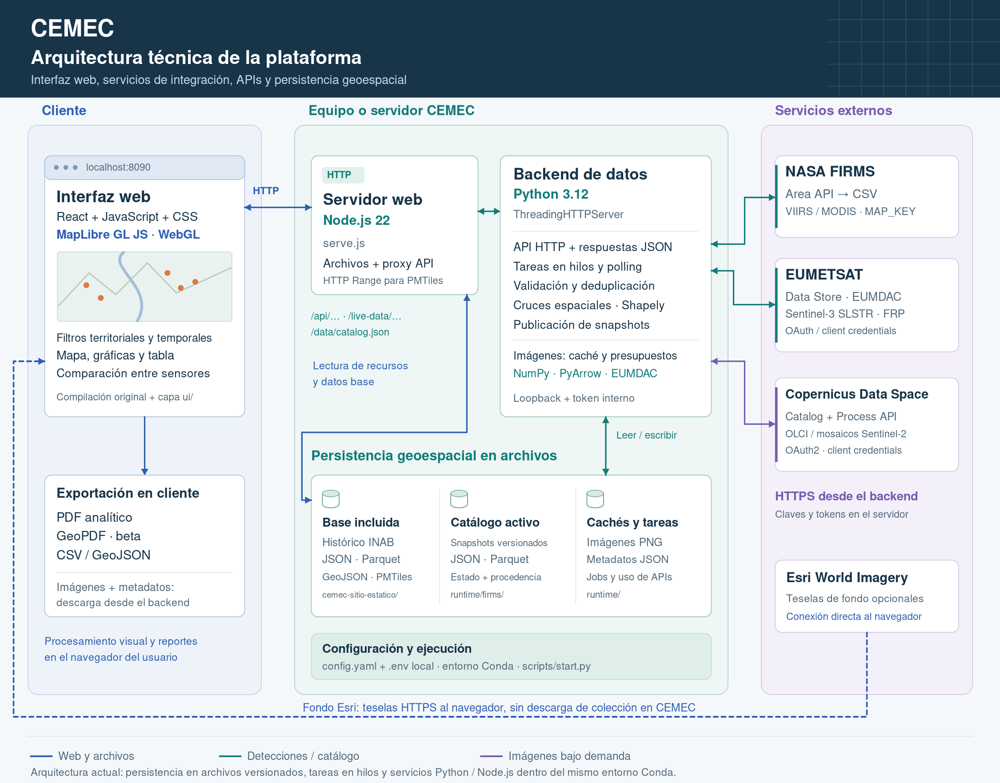

# Diagrama de arquitectura y flujo de CEMEC

## Arquitectura técnica · portada del repositorio

[](cemec-arquitectura-tecnica.svg)

- [PNG de arquitectura](cemec-arquitectura-tecnica.png): 2250 × 1762 píxeles para la portada y presentaciones.
- [SVG técnico editable](cemec-arquitectura-tecnica.svg): texto seleccionable y descripción accesible.
- [Generador reproducible](../../scripts/build_architecture_diagram.py): Python estándar; PNG exportado con ImageMagick.

Representa la implementación revisada el 26 de octubre de 2026, con tres límites de ejecución: navegador, equipo o servidor CEMEC y servicios externos. Los bloques del servidor son responsabilidades de dos procesos locales; no representan microservicios desplegados por separado.

### Componentes y conexiones

| Componente | Tecnología y responsabilidad | Referencia |
| --- | --- | --- |
| Cliente web | Compilación original React, presentación JavaScript/CSS en `ui/`, mapa MapLibre GL JS/WebGL; filtros, gráficos y comparación. | `ui/cemec-view.js`, `ui/cemec-ui.css`, `scripts/frontend_patch.cjs` |
| Servidor web | Node.js 22, módulos nativos HTTP/FS: HTML, JS, CSS, recursos, rangos HTTP para PMTiles y proxy del backend. | `serve.js` |
| API interna | Python 3.12, `ThreadingHTTPServer`, respuestas JSON y archivos; tareas en `ThreadPoolExecutor`, consulta de progreso por polling y control de acceso interno por token. | `scripts/firms_backend.py`, `scripts/start.py` |
| Integración de detecciones | FIRMS Area API/CSV y EUMETSAT/EUMDAC; validación, normalización, deduplicación y cruces espaciales Shapely. | `scripts/firms_backend.py`, `scripts/eumetsat_client.py` |
| Imágenes de contexto | CDSE OAuth2, Catalog y Process API; preparación de OLCI y mosaicos trimestrales Sentinel-2, caché y presupuestos. | `scripts/olci_service.py`, `scripts/mosaic_service.py` |
| Persistencia | Archivos JSON/GeoJSON/Parquet y recursos PMTiles; snapshots versionados, estado activo, manifiestos de procedencia, imágenes, tareas y consumo. | `cemec-sitio-estatico/`, `runtime/` |
| Exportación | Reporte analítico, CSV/GeoJSON y GeoPDF beta en navegador; imágenes y metadatos obtenidos del backend para su descarga. | Compilación original, `ui/geopdf.js`, `ui/olci-layer.js` |
| Configuración | `config.yaml` y `.env` local, servicios iniciados desde el entorno Conda dedicado. | `environment.yml`, `scripts/start.py` |

**Persistencia no equivale a un servidor de base de datos:** actualmente no se utiliza PostgreSQL/PostGIS, SQLite ni una cola distribuida. La integración construye el snapshot antes de activar el nuevo catálogo; el histórico original permanece disponible. Las cachés y snapshots operativos no se incluyen en Git.

Node reenvía `/api/…`, `/live-data/…` y `/data/catalog.json` a Python por `127.0.0.1`, añadiendo un token interno efímero. Las demás rutas autorizadas se sirven desde archivos. Este token controla la comunicación entre procesos; no representa cuentas o roles de usuarios. Las claves de los proveedores permanecen en el servidor y no están en el diagrama ni en el repositorio.

La ruta Esri es distinta: el navegador solicita directamente las teselas al activar el fondo. Las solicitudes de imágenes CDSE pasan por Python. Las detecciones FIRMS/EUMETSAT se sincronizan por acción del operador; el diagrama no representa actualizaciones periódicas automáticas. El portal SIG beta se mantiene fuera de este esquema centrado en monitoreo.

Para regenerar desde la raíz:

```bash
python scripts/build_architecture_diagram.py
convert -background white -density 120 docs/diagramas/cemec-arquitectura-tecnica.svg docs/diagramas/cemec-arquitectura-tecnica.png
```

## Vista funcional complementaria · 26 de octubre de 2026

[](cemec-plataforma-flujo.svg)

- [PNG de portada](cemec-plataforma-flujo.png): 2250 × 1590 píxeles, fondo blanco, apto para GitHub y presentaciones.
- [SVG escalable](cemec-plataforma-flujo.svg): editable, con descripción accesible y texto seleccionable.
- [Generador reproducible](../../scripts/build_overview_diagram.py): Python estándar; no consulta APIs ni usa credenciales.

El recorrido resume tres etapas: fuentes, gestión de datos en CEMEC y consulta de resultados. Se distinguen dos rutas:

1. **Detecciones térmicas:** el histórico INAB y las consultas manuales de FIRMS y EUMETSAT forman el catálogo. La integración valida y normaliza observaciones y controla duplicados; registra su procedencia.
2. **Imágenes de contexto:** Copernicus aporta OLCI y mosaicos trimestrales Sentinel-2 bajo demanda, con caché y límites de consumo. Estas imágenes no generan nuevas detecciones ni se fusionan con el catálogo térmico.

El usuario selecciona territorio, período, fuente y sensor, consulta el mapa, las gráficas y los registros, y comparte reportes o datos. Las imágenes y sus metadatos se descargan por separado. El mapa PDF georreferenciado conserva su condición beta. Los fondos cartográficos y el puente SIG externo se omiten para mantener legible esta síntesis; siguen disponibles en la aplicación.

Es un flujo conceptual, no un diagrama de microservicios ni una promesa de sincronización programada. El navegador consulta los servicios del equipo o servidor donde se instala CEMEC. Las detecciones requieren interpretación y verificación en campo.

Para regenerar los archivos desde la raíz (PNG requiere ImageMagick):

```bash
python scripts/build_overview_diagram.py
convert -background white -density 144 docs/diagramas/cemec-plataforma-flujo.svg docs/diagramas/cemec-plataforma-flujo.png
```

## Diagramas de la presentación original

Material para la presentación ante CEMEC, preparado el 21 de octubre de 2026.

- [PNG para insertar en las láminas](arquitectura-flujo-cemec.png): 3302 × 2322 píxeles, fondo blanco.
- [SVG editable y escalable](arquitectura-flujo-cemec.svg): puede abrirse en un navegador o editor vectorial.
- [Fuente Mermaid](arquitectura-flujo-cemec.mmd): conserva el flujo lógico del diagrama compartido en la conversación.

El SVG y PNG se exportaron directamente de la fuente Mermaid mostrada en el
chat, conservando sus textos, conexiones, grupos y figuras. La variante anterior
en columnas se conserva con el sufijo `-columnas`, pero no es la exportación
original solicitada. El diagrama es conceptual: resume los servicios locales y no
representa procesos independientes para cada recuadro. La interfaz compilada se
sirve con Node.js y el backend Python integra los proveedores y gestiona los datos.

Las detecciones térmicas se sincronizan manualmente y se incorporan al catálogo
local. Las imágenes se solicitan por separado y se reutilizan mediante caché.
Esri entrega teselas al navegador al activar ese fondo. Los reportes térmicos PDF
no incorporan automáticamente las imágenes satélites de contexto: estas y sus
metadatos se descargan por separado.
