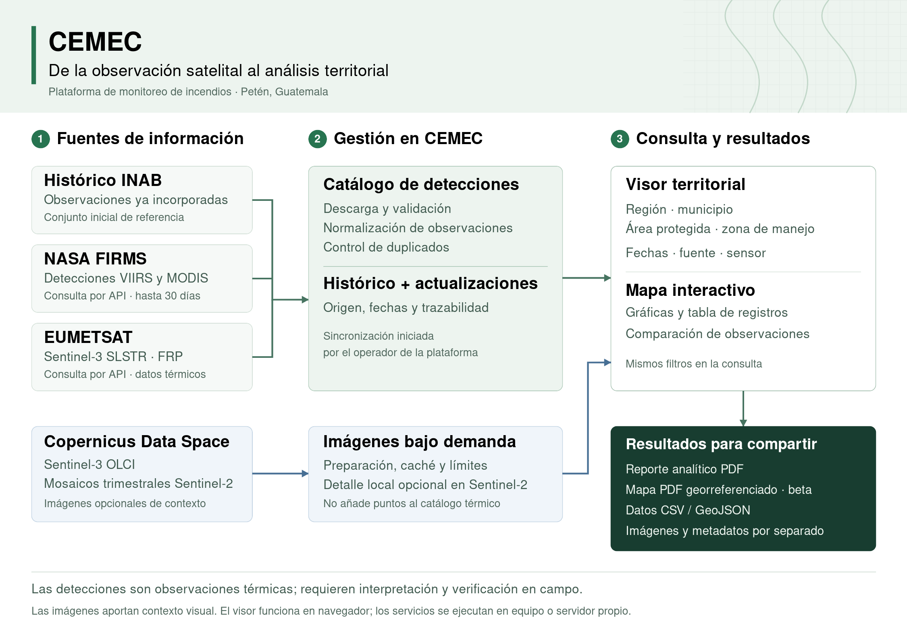

# Diagrama de arquitectura y flujo de CEMEC

## Portada del repositorio · 26 de octubre de 2026

[](cemec-plataforma-flujo.svg)

- [PNG de portada](cemec-plataforma-flujo.png): 2250 × 1590 píxeles, fondo blanco, apto para GitHub y presentaciones.
- [SVG escalable](cemec-plataforma-flujo.svg): editable, con descripción accesible y texto seleccionable.
- [Generador reproducible](../../scripts/build_overview_diagram.py): Python estándar; no consulta APIs ni usa credenciales.

El recorrido resume tres etapas: fuentes, gestión de datos en CEMEC y consulta de resultados. Se distinguen dos rutas:

1. **Detecciones térmicas:** el histórico INAB y las consultas manuales de FIRMS y EUMETSAT forman el catálogo. La integración valida y normaliza observaciones y controla duplicados; registra su procedencia.
2. **Imágenes de contexto:** Copernicus aporta OLCI y mosaicos trimestrales Sentinel-2 bajo demanda, con caché y límites de consumo. Estas imágenes no generan nuevas detecciones ni se fusionan con el catálogo térmico.

El usuario selecciona territorio, período, fuente y sensor, consulta el mapa, las gráficas y los registros, y comparte reportes o datos. Las imágenes y sus metadatos se descargan por separado. El mapa PDF georreferenciado conserva su condición beta. Los fondos cartográficos y el puente SIG externo se omiten para mantener legible esta síntesis; siguen disponibles en la aplicación.

Es un flujo conceptual, no un diagrama de microservicios ni una promesa de sincronización programada. El navegador consulta los servicios del equipo o servidor donde se instala CEMEC. Las detecciones requieren interpretación y verificación en campo.

Para regenerar los archivos desde la raíz (PNG requiere ImageMagick):

```bash
python scripts/build_overview_diagram.py
convert -background white -density 144 docs/diagramas/cemec-plataforma-flujo.svg docs/diagramas/cemec-plataforma-flujo.png
```

## Diagramas de la presentación original

Material para la presentación ante CEMEC, preparado el 21 de octubre de 2026.

- [PNG para insertar en las láminas](arquitectura-flujo-cemec.png): 3302 × 2322 píxeles, fondo blanco.
- [SVG editable y escalable](arquitectura-flujo-cemec.svg): puede abrirse en un navegador o editor vectorial.
- [Fuente Mermaid](arquitectura-flujo-cemec.mmd): conserva el flujo lógico del diagrama compartido en la conversación.

El SVG y PNG se exportaron directamente de la fuente Mermaid mostrada en el
chat, conservando sus textos, conexiones, grupos y figuras. La variante anterior
en columnas se conserva con el sufijo `-columnas`, pero no es la exportación
original solicitada. El diagrama es conceptual: resume los servicios locales y no
representa procesos independientes para cada recuadro. La interfaz compilada se
sirve con Node.js y el backend Python integra los proveedores y gestiona los datos.

Las detecciones térmicas se sincronizan manualmente y se incorporan al catálogo
local. Las imágenes se solicitan por separado y se reutilizan mediante caché.
Esri entrega teselas al navegador al activar ese fondo. Los reportes térmicos PDF
no incorporan automáticamente las imágenes satélites de contexto: estas y sus
metadatos se descargan por separado.
