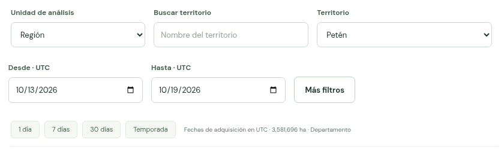
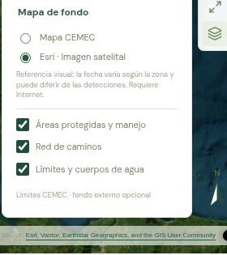
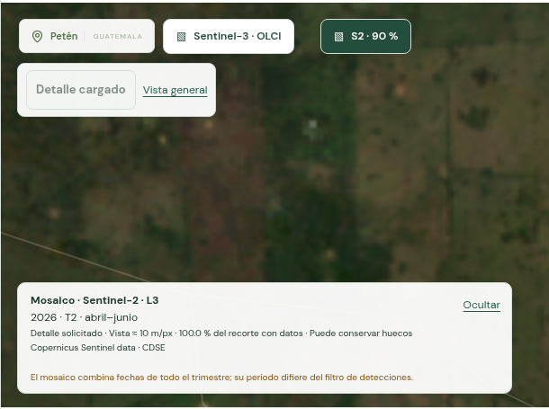

# Manual de uso e interpretación de CEMEC

Consulta territorial de observaciones térmicas e imágenes de contexto

Versión documental 1.1 | Plataforma revisada el 19 de octubre de 2026

Este manual explica cómo recorrer la plataforma, seleccionar territorios y fechas, interpretar sensores y calidad, consultar imágenes, comparar observaciones, descargar datos y generar reportes. Incluye los procedimientos de actualización para operadores y ejercicios guiados. El manual de instalación distingue acceso por navegador, preparación local de Windows nativo, alternativa WSL2, credenciales y mantenimiento técnico.

CEMEC presenta observaciones satelitales y su contexto. Un punto no identifica necesariamente un incendio individual; varios puntos pueden pertenecer al mismo evento y un evento puede no ser observado. Las imágenes RGB y el fondo Esri ayudan a reconocer el territorio, pero no confirman por sí solos presencia de fuego, superficie quemada o gravedad.

## 1 Primer recorrido

### Abrir la plataforma desde Windows

Si la plataforma está instalada y disponible en un servidor, abra la dirección facilitada por el responsable en Edge, Chrome o Firefox. Para consultar mapas, datos y reportes no necesita instalar Ubuntu, WSL2, Conda, Python ni claves de API en su computadora. El servidor conserva la configuración y las conexiones.

Si está ejecutándose en la misma computadora, utilice la dirección y el puerto anunciados por el responsable, por ejemplo http://localhost:8090. Localhost se refiere a ese equipo; no sirve para identificar una instancia remota en otra computadora.

Si usted también instala y opera el servidor, consulte el manual de instalación. La preparación de Windows nativo y la alternativa WSL2 están separadas: la primera requiere completar y validar los ajustes de portabilidad del backend actual; WSL2 permite reutilizar los scripts Linux. Este manual de uso no presenta ninguna de ellas como una instalación obligatoria para los usuarios del navegador.

No inicie otro servidor si ya hay una instancia funcionando. Cerrar la pestaña o el navegador no detiene la instancia ni cancela necesariamente una tarea del servidor.

### Resolver una primera consulta

1. En Explorar, elija Unidad de análisis y Territorio.
2. Defina Desde y Hasta, ambas fechas de adquisición en UTC.
3. Revise las etiquetas de filtros activos. Para comenzar use todas las fuentes e instrumentos.
4. Observe el número de detecciones, los días con observaciones y los sensores representados.
5. Examine el mapa, la pestaña Análisis y la pestaña Registros.
6. Abra Fuentes y sensores y revise el estado y la ventana de las últimas consultas.
7. Si necesita un documento, pulse Generar reporte; si necesita las filas, Descargar datos.

La pantalla comienza con los últimos siete días UTC y todos los instrumentos. Si el catálogo no contiene observaciones recientes, puede mostrar cero. Seleccione un período dentro del corte indicado en Datos o utilice Temporada para explorar el año. Ningún cambio de fecha en el visor descarga automáticamente detecciones nuevas.

### Tres comprobaciones antes de interpretar

Compruebe el territorio, el período y la disponibilidad de las fuentes. Una selección correcta sobre un catálogo desactualizado no representa necesariamente la situación actual. La fecha de última consulta y la fecha de última observación son conceptos distintos.

## 2 Organización de la interfaz

| Área | Qué permite hacer |
|---|---|
| Explorar | Seleccionar territorio y fechas, aplicar filtros y consultar mapa, análisis y registros. |
| Datos | Descargar la selección o archivos completos; consultar versiones y particiones. |
| Fuentes y sensores | Entender procedencia, resolución y limitaciones; revisar estado de consultas y entrar a la comparación. |
| Comparar observaciones | Examinar dos combinaciones de fuente e instrumento en el mismo territorio y período. |
| Generar reporte | Revisar el alcance y generar un PDF de la selección o comparación. |
| Administración | Abrir Ajustes, Importar datos y Mapas y lotes. No es un sistema de autenticación. |

La cabecera informa la última consulta exitosa registrada y la última observación incorporada. Los avisos de disponibilidad indican si falló una actualización o si la selección excede la última ventana consultada de alguna fuente. No desaparecen necesariamente al cambiar de pestaña: describen el estado de los datos.

Las ventanas de opciones se pueden cerrar con Escape. En las pestañas de resultados se puede navegar con flechas, Inicio y Fin. Las gráficas de observaciones diarias ofrecen una tabla de valores. En móvil los controles se reorganizan; revise los paneles y desplazamientos antes de interpretar un contenido parcialmente visible.

## 3 Fuentes sensores y productos

### Diferenciar los conceptos

La fuente o proveedor distribuye los datos. El sensor realiza la observación. El satélite transporta el sensor. El producto define procesamiento, variables y calidad. Por ejemplo, NASA FIRMS distribuye detecciones VIIRS de NOAA-20; EUMETSAT distribuye el producto FRP de SLSTR en Sentinel-3. INAB identifica la procedencia institucional del histórico, no un instrumento satelital.

| Sensor o fondo | Función en CEMEC | Resolución o detalle nominal | Acceso implementado |
|---|---|---|---|
| VIIRS | Detecciones térmicas | 375 m para el producto integrado | Histórico y sincronización FIRMS en S-NPP, NOAA-20 y NOAA-21. |
| MODIS | Detecciones térmicas | 1 km para el producto integrado | Histórico y sincronización FIRMS en Terra y Aqua. |
| SLSTR de Sentinel-3 | Detecciones y FRP MWIR | 1 km para la variante integrada | Sincronización EUMETSAT, Sentinel-3A y Sentinel-3B. |
| ABI de GOES | Detecciones del archivo cuando existen | Aproximadamente 2 km en el punto subsatelital del producto; el tamaño crece con la geometría de visión | Histórico y archivos; no hay un conector ABI nuevo en esta versión. |
| OLCI de Sentinel-3 | Imagen RGB de contexto | 300 m nominales | CDSE; imagen de la pasada o ventana elegida. No añade detecciones. |
| Sentinel-2 L3 trimestral | Mosaico RGB de contexto | Bandas RGB de 10 m nominales; salida regional más gruesa | CDSE; último trimestre publicado o trimestre elegido. |
| Esri World Imagery | Fondo de referencia visual | Variable según zona, fuente y zoom | Servicio externo de teselas; fecha variable. |

La resolución nominal describe una escala del producto. No significa que cada punto sea una parcela de ese tamaño quemada ni que todos los incendios menores sean invisibles. La imagen dibujada puede ser más gruesa que el sensor por el tamaño de salida solicitado.

### Por qué no coinciden los sensores

Las pasadas, hora, ángulo de visión, bandas, resolución, umbrales y condiciones atmosféricas cambian entre observaciones. Nubes, humo, dosel y duración del evento pueden impedir una detección. No interprete una diferencia de conteo como error automático ni como una medida directa de mejor calidad.

VIIRS y MODIS integrados desde FIRMS son productos NRT. Una publicación posterior de mayor calidad puede diferir. La plataforma acumula lo incorporado y no elimina automáticamente registros que un proveedor retire más tarde.

### Dos funciones diferentes en Sentinel-3

Sentinel-3 OLCI muestra luz reflejada como contexto visual. Sentinel-3 SLSTR aporta las detecciones térmicas del conector EUMETSAT. Comparten misión, pero no variable, resolución ni mecanismo de acceso. Cargar una imagen OLCI no sincroniza SLSTR; sincronizar SLSTR no coloca una imagen RGB en el mapa.

## 4 Significado de los datos

### Diccionario de observaciones

| Campo o indicador | Significado y precaución |
|---|---|
| Detecciones térmicas | Número de registros que cumplen los filtros. No es número de incendios únicos. |
| Días con observaciones | Días de la selección que tienen al menos un registro. No representa cobertura satelital diaria completa. |
| Sensores con observaciones | Instrumentos presentes en los registros seleccionados. No enumera todos los sensores que pudieron sobrevolar la zona. |
| Fecha y hora UTC | Adquisición de la observación; no es hora de descarga ni de publicación. |
| Latitud y longitud | Coordenadas en grados. En Guatemala la longitud es negativa. La precisión decimal no equivale a exactitud física. |
| Satélite | Plataforma identificada por el producto, por ejemplo NOAA-20 o Sentinel-3B. |
| Instrumento | VIIRS, MODIS, SLSTR o ABI, según el registro. |
| Fuente | Procedencia conservada en el catálogo; sirve para distinguir histórico, FIRMS y EUMETSAT. |
| Confianza | Clase del producto, mostrada como alta, nominal, baja o sin clasificar. No es una escala común de riesgo. |
| FRP en MW | Potencia radiativa del fuego estimada por el producto, en megavatios. No es área quemada, energía acumulada ni gravedad por sí sola. |
| Día o noche | Clasificación disponible en el registro; D es día y N noche. Un valor vacío no se debe asignar artificialmente. |
| Versión del producto | Referencia al procesamiento conservado; necesaria para trazabilidad y comparaciones. |
| Unidades territoriales | Territorios asociados a la observación. Un punto puede pertenecer a varias categorías superpuestas. |

Los exportables pueden incluir observation_utc, confidence_class, confidence_scheme, product_id, entry y raw_fields. observation_utc conserva segundos cuando la fuente los aporta; product_id y entry permiten rastrear el producto y archivo; raw_fields conserva atributos originales y su interpretación requiere consultar el producto. La ausencia de un atributo no significa cero.

### Interpretar confianza

Para VIIRS se conservan las clases disponibles del producto. La normalización actual de valores numéricos de confianza de MODIS utiliza baja si es menor que 30, nominal desde 30 hasta menos de 80 y alta desde 80. Esto describe las etiquetas de esta implementación; no convierte la confianza en probabilidad de incendio.

SLSTR conserva su clasificación original: 0 baja, 1 nominal y 2 alta cuando el CSV contiene ese campo. Si no lo contiene, se muestra sin clasificar. No se aplican los umbrales numéricos de MODIS a SLSTR. En el histórico se conservan las categorías recibidas, cuya procedencia debe revisarse para análisis detallados.

Filtrar solo confianza alta puede excluir observaciones útiles y cambia el conjunto que se compara. Si una fuente deja de mostrar filas, compruebe primero si dispone de clasificación. Sin clasificar no significa baja.

### FRP y estadísticas

La FRP media se calcula con valores disponibles. Un dato ausente no se completa con cero. Sumar FRP de observaciones repetidas a distintas horas no produce automáticamente la potencia simultánea de un evento ni la energía total liberada. Para comparaciones científicas revise producto, hora, geometría y calidad.

## 5 Unidad de análisis y territorio

### Selección territorial

1. Abra Unidad de análisis.
2. Elija Región, Municipio, Área protegida o Zona de manejo.
3. Si la lista es extensa, escriba parte del nombre en Buscar territorio.
4. Seleccione el territorio en la lista y espere a que el mapa se centre.
5. Compruebe el nombre activo y su categoría antes de exportar.

Buscar territorio ayuda a encontrar nombres; no dibuja un área libre ni crea una jurisdicción nueva. El mapa también permite seleccionar municipios desde sus etiquetas. El territorio determina los registros utilizados para las estadísticas y productos de la selección.

### Superposiciones

Un municipio puede intersectar un área protegida y una zona de manejo. La misma observación puede aparecer en cada una de sus consultas. No sume sus totales como si fueran grupos excluyentes. La suma de categorías superpuestas puede exceder el total regional sin que exista una duplicación de filas en el catálogo.

### Áreas de consulta de los proveedores

Cuando están presentes, Área de consulta FIRMS y Área de consulta EUMETSAT representan rectángulos de descarga. Permiten revisar observaciones externas a los límites institucionales originales. No son límites legales y su superficie es aproximada. Puntos fuera de Petén no se asignan artificialmente a un municipio.

Cambiar de territorio retira la imagen OLCI o Sentinel-2 anterior. Esto evita presentar una composición de otra unidad como si correspondiera a la nueva. La caché puede reutilizarse al volver a cargar la misma imagen.

## 6 Fechas y filtros

### Período de consulta

Desde y Hasta filtran las fechas de adquisición en UTC. Los accesos 1 día, 7 días, 30 días y Temporada calculan ventanas con referencia a la fecha UTC actual; Temporada comienza el 1 de enero del año actual. Si necesita un año anterior o un episodio concreto, introduzca ambas fechas manualmente.

UTC y hora local no son intercambiables. En Guatemala y Costa Rica, una observación de las 02:00 UTC corresponde a las 20:00 del día anterior con el desfase UTC menos seis horas. Revise la etiqueta: las fechas de filtro y registros son UTC, mientras que ciertos estados y la referencia de imagen se presentan con hora de Guatemala.

### Más filtros

| Control | Uso |
|---|---|
| Fuente de datos | Todas las fuentes, Histórico y archivos, NASA FIRMS o EUMETSAT. |
| Instrumento | Todos, VIIRS, MODIS, SLSTR o ABI. La existencia de la opción no garantiza filas en la selección. |
| Confianza del producto | Todas, Alta, Nominal, Baja o Sin clasificar. |
| Observación | Día, noche y sin dato; solo día; o solo noche. |
| Satélites | Selección dentro de los disponibles para el instrumento. Todos los satélites restablece el conjunto. |
| Color del mapa | Sensor o Confianza del producto; cambia representación, no las filas. |

Los filtros se combinan. Por ejemplo, fuente EUMETSAT e instrumento VIIRS no representa una combinación del conector actual y puede dar cero. Al cambiar instrumento se restablece la selección de satélites. Si desmarca todos puede quedar una selección sin satélites y sin resultados; use Todos los satélites para recuperarla.

Las etiquetas bajo los controles muestran restricciones activas y se pueden quitar individualmente. Restablecer filtros, dentro de Más filtros, conserva territorio y fechas. Restablecer de la consulta principal recupera la configuración inicial, incluida región y ventana reciente; revise siempre la selección resultante.

### Por qué puede aparecer cero

Puede no haber observaciones, faltar una actualización, estar fuera de la disponibilidad del producto o existir filtros incompatibles. Un filtro de noche excluye registros sin clasificación; uno de confianza alta excluye los sin clasificar. Revise primero todas las fuentes, todos los instrumentos y un período con datos publicados antes de asumir un fallo.

## 7 Mapa y panel de capas

### Navegación e inspección

Arrastre para desplazarse y use Acercar y Alejar o la rueda para modificar el zoom. Centrar territorio recupera la extensión de la unidad seleccionada. Pantalla completa amplía el espacio de trabajo. El navegador debe permitir WebGL.

Pulse un punto para abrir su detalle: satélite e instrumento, fecha y hora UTC, confianza, FRP, coordenadas y fuente. Cierre la ficha para volver a examinar el mapa. El tamaño y el color del símbolo no representan una superficie quemada.

Color por sensor utiliza VIIRS naranja, MODIS violeta, SLSTR azul y ABI verde azulado. Color por confianza utiliza sus categorías. Consulte la leyenda activa; no interprete el azul como menor peligro ni el naranja como mayor intensidad.

### Capas del mapa

Abra el botón Capas del mapa. Puede mostrar u ocultar Áreas protegidas y manejo y Red de caminos. La opción Límites y cuerpos de agua es informativa en el panel actual y permanece activada; no es un interruptor adicional funcional. Estas opciones cambian la representación, no la consulta territorial ni los conteos.

### Fondo Esri

En Mapa de fondo elija Mapa CEMEC o Esri · Imagen satelital. CEMEC es el predeterminado. Esri se solicita solo al seleccionarlo; volver a CEMEC retira su fuente y detiene nuevas solicitudes de ese fondo. Cerrar el panel conserva la selección, pero recargar la página la restablece.

Esri es un contexto de fecha variable. No utiliza el filtro temporal, no ofrece una fecha única para todo el mapa y no garantiza actualidad respecto a la detección. Los créditos del proveedor están en la atribución cartográfica. Si falla una tesela, el visor vuelve a CEMEC y muestra un aviso. Reintente después de revisar la conexión.

Esri puede permanecer debajo de una imagen OLCI o Sentinel-2, que se dibuja por encima con su opacidad. Esri no utiliza las credenciales ni las unidades de procesamiento de CDSE. Los mapas de comparación ofrecen su propio selector de fondo.

## 8 Imágenes de Sentinel 3 OLCI

### Cargar la última imagen disponible

1. En el mapa de Explorar pulse Sentinel-3 · OLCI.
2. Mantenga Última disponible y pulse Buscar última imagen.
3. Espere la búsqueda y preparación; no repita clics mientras siga en curso.
4. Revise satélite, fecha y hora de referencia, cobertura y cualquier aviso temporal.

La búsqueda revisa primero siete días y, si está vacía, hasta treinta. Última significa la referencia más reciente encontrada que intersecta el territorio, no una garantía de escena sin nubes ni de cobertura total.

### Elegir un período y una referencia

Seleccione Elegir período, introduzca Desde y Hasta en UTC y pulse Buscar imágenes. El período puede tener hasta 366 días. Si aparecen referencias, elija Pasada disponible y pulse Mostrar esta imagen. Si no hay resultados, amplíe fechas o cambie territorio; una búsqueda vacía no modifica las detecciones térmicas.

El procesamiento usa una ventana alrededor de la referencia, de aproximadamente diez minutos antes y después, y puede combinar segmentos o versiones. La referencia del catálogo no significa que el PNG sea una descarga íntegra e idéntica de un archivo original.

### Mostrar opacidad y descargar

En el panel puede activar Mostrar imagen en el mapa y ajustar Opacidad. Ocultar en la leyenda retira su visualización. Descargar imagen entrega PNG; Metadatos entrega JSON con extensión, proyección, bandas, período, cobertura, hash y consumo reportado. Guarde ambos: el PNG por sí solo no conserva toda la información de georreferenciación.

OLCI tiene unos 300 m nominales. Ampliar sus píxeles no produce detalle de parcelas ni una imagen de 10 m. El botón de recorte OLCI fue retirado porque no aportaba detalle físico adicional. Cargar OLCI no modifica el catálogo de SLSTR ni realiza una sincronización EUMETSAT.

Cobertura con datos expresa píxeles con información dentro de la estimación usada; una nube puede seguir contando como dato. Un 100 % no significa territorio despejado. Si la imagen queda fuera del período de detecciones, el visor lo advierte.

## 9 Mosaicos trimestrales de Sentinel 2

### Seleccionar el trimestre

Pulse Sentinel-2 · Mosaico. Último publicado consulta el trimestre más reciente realmente disponible; puede existir retraso después del cierre. Elegir trimestre permite seleccionar año y T1 enero a marzo, T2 abril a junio, T3 julio a septiembre o T4 octubre a diciembre, y pulsar Cargar trimestre.

Los trimestres abiertos no están disponibles para esta consulta. Uno terminado puede no estar publicado todavía. Si no existe, el visor informa sin sustituirlo silenciosamente por otro. Las respuestas de catálogo, incluidas las vacías, se conservan durante 24 horas; una novedad remota puede no aparecer inmediatamente.

### Qué representa la imagen

El producto L3 oficial combina observaciones del trimestre y selecciona valores por banda después de filtrar observaciones. No representa una pasada ni una fecha única y puede conservar nubes residuales o huecos. No sirve para confirmar el estado de un incendio en un día concreto.

La vista general se prepara para el rectángulo regional compartido de Petén, limitada a 1024 píxeles por lado. Puede reutilizarse entre municipios contenidos en él. Por eso el fondo tiene menor detalle que los 10 m nominales de las bandas RGB. La escala efectiva aparece sobre el mapa; en la medición regional inicial fue cercana a 240 m/px.

La cobertura mostrada para la unidad se estima con centros de píxel y no equivale a superficie libre de nubes. Para zonas muy pequeñas puede no haber una estimación suficiente. La imagen sigue cubriendo un rectángulo; los límites territoriales se superponen para orientar la lectura.

### Cargar detalle de esta zona

1. Cargue y active el mosaico.
2. Acérquese a un área de interés dentro de la extensión disponible.
3. Espere a que Cargar detalle de esta zona quede habilitado. El control muestra una estimación de escala y superficie.
4. Pulse el botón una vez y espere. La vista general permanece debajo del recorte.
5. Use Vista general para retirar el detalle sin una nueva consulta de procesamiento.

El detalle conserva trimestre y producto de origen. No busca una escena reciente. El objetivo es acercarse a 10 m/px, con máximo de 1024 píxeles por lado, 400 km² y 30 km por lado. Un recorte mayor puede resultar más grueso. Acercarse aún más a una salida de 10 m no revela detalle físico adicional.

El zoom y el desplazamiento por sí solos no descargan un nuevo recorte. El servidor ajusta la extensión a una cuadrícula para reutilizar vistas próximas. Si el detalle ya cubre la vista con resolución suficiente aparece Detalle cargado. Al desplazarse fuera de él se sigue viendo la imagen general; otra solicitud necesita un clic.

### Presupuesto y descargas

Vistas generales y detalles comparten seis intentos nuevos por día UTC para todo el proyecto, incluidos los fallidos. Los aciertos de caché siguen disponibles al alcanzar el límite. El contador local no sustituye la cuota total de CDSE ni incluye todas las llamadas de otras herramientas de la cuenta.

Si hay un detalle activo, Descargar imagen y Metadatos corresponden a ese recorte. Su cobertura se refiere al recorte, no al municipio completo. Cambiar de unidad o cargar otro trimestre retira el detalle anterior. Si falla una solicitud, la imagen anterior se conserva. Solo una composición CDSE, OLCI o Sentinel-2, permanece activa a la vez.

## 10 Análisis e indicadores

Abra la pestaña Análisis después de fijar la selección. La vista conserva los filtros principales y presenta evolución temporal, distribución por satélite, municipios en la selección y calidad de observación. Los resultados cambian al modificar territorio, fechas, fuente o cualquier restricción.

### Lectura de la serie temporal

Cada barra cuenta observaciones almacenadas en una fecha UTC. Varias pasadas pueden producir varios registros del mismo episodio. Un pico puede reflejar mayor actividad observada, mayor cobertura de satélites o una combinación. Un día con cero no demuestra que la zona se observó completamente sin fuego.

En el mapa de Explorar, Observaciones por día ofrece Ver valores por día para revisar las cifras de la gráfica. Use esa tabla para verificar una lectura visual y conserve la ventana consultada de cada fuente.

### Distribución territorial y calidad

La distribución por satélite permite identificar qué plataformas aportan las observaciones. La lista de municipios ayuda a ubicar concentraciones, pero no corrige por superficie municipal, población, uso del suelo, nubosidad o número de pasadas. Un municipio grande puede acumular más observaciones sin tener mayor densidad relativa.

Las categorías de confianza se mantienen por producto. FRP media utiliza los valores disponibles, no convierte los ausentes en cero. Ninguna de estas estadísticas constituye por sí sola un índice de riesgo o una evaluación de daños.

Para una comparación espacial formal, defina primero una métrica, el denominador y la cobertura temporal. CEMEC no calcula automáticamente tasas normalizadas por oportunidad de observación ni elimina diferencias metodológicas entre sensores.

## 11 Registros y descarga de la selección

### Tabla de observaciones

La pestaña Registros permite revisar fecha y hora UTC, satélite, coordenadas, confianza, FRP y fuente. El buscador local ayuda a localizar una fecha, satélite o coordenada. Las opciones de orden incluyen Más recientes primero y Mayor FRP primero. Use Anterior y Siguiente para recorrer páginas.

El buscador y la paginación facilitan inspeccionar la tabla; no sustituyen los filtros globales. Descargar datos utiliza la selección global de territorio, período y filtros, no únicamente la página visible ni el texto buscado en la tabla. Compruebe el conteo del diálogo antes de guardar.

### Formatos

Pulse Descargar datos y elija CSV o GeoJSON. CSV contiene atributos y es adecuado para revisión tabular. GeoJSON conserva geometrías de puntos y puede abrirse en un SIG. Las columnas adicionales de trazabilidad dependen de la fuente y del producto disponible.

Al abrir CSV en Excel, impórtelo como archivo de texto UTF-8 y revise separador y tipos. Mantenga identificadores y horas como texto cuando sea necesario para conservar ceros iniciales. No convierta coordenadas a fechas ni elimine el signo negativo de la longitud. Un archivo GeoJSON se interpreta en coordenadas geográficas; no cambie la proyección asignándole otra sin transformación.

Archive el exportable junto al territorio, período, filtros, versión del catálogo y propósito del análisis. Un CSV por sí solo no acredita cobertura completa del proveedor ni una evaluación de campo.

### Datos ausentes

Una FRP vacía es un valor no disponible. Una fila sin clase no debe completarse como baja. Algunos segundos o campos originales pueden no existir en las fuentes históricas. Para análisis reproducibles distinga ausencia de atributo, cero numérico y categoría sin clasificar.

## 12 Comparar observaciones

Desde Fuentes y sensores pulse Comparar observaciones. Se conservan territorio, fechas y restricciones de Explorar. Cada lado permite elegir una combinación como NASA FIRMS VIIRS, NASA FIRMS MODIS, EUMETSAT SLSTR o un instrumento del histórico.

### Procedimiento recomendado

1. Antes de entrar, seleccione el mismo territorio y período relevante.
2. En Más filtros ponga todas las fuentes e instrumentos, y revise satélites, confianza y día o noche.
3. Elija la combinación A y la combinación B.
4. Examine conteos, mapas y series separados; los mapas sincronizan centro y zoom.
5. Revise las ventanas consultadas y el estado de los dos proveedores.
6. Si necesita conservar la comparación, genere su reporte PDF.

Los filtros globales siguen aplicándose antes de formar cada lado. Si permanece Fuente NASA FIRMS o Instrumento VIIRS, el lado EUMETSAT SLSTR puede quedar vacío por esa restricción. Cambiar las opciones A y B no anula esos filtros.

### Qué conclusiones permite

Permite identificar coincidencias o diferencias visuales y temporales entre registros almacenados. No realiza un emparejamiento validado de eventos ni demuestra que una fuente detectó más incendios reales. Las dos columnas no deben sumarse como incendios únicos.

Los mapas de comparación ofrecen fondos CEMEC o Esri. Las consultas de imágenes OLCI y Sentinel-2 están en Explorar, no en estos mapas. El reporte de comparación conserva las dos selecciones y utiliza sus observaciones; verifique etiquetas y restricciones antes de generarlo.

## 13 Generar reportes y productos

### Reporte de la selección actual

1. Termine de configurar territorio, fechas y filtros.
2. Pulse Generar reporte.
3. Revise el resumen de unidad, período UTC, fuente, instrumentos, satélites, confianza y día o noche.
4. Si corresponde, active Incluir tabla de registros.
5. Pulse Generar PDF y espere la descarga del navegador.
6. Abra el PDF y revise que el título, las cifras, fechas y fuentes correspondan a la consulta.

El PDF incluye mapa de detecciones y límites, resumen territorial, evolución, resultados por fuente y sensor, estado de consultas, metodología y limitaciones. Una selección vacía puede documentarse, pero el reporte indica que no hay observaciones coincidentes y no demuestra ausencia de fuego.

Generar es una acción al pulsar: no hay un envío periódico, una programación de reportes o un servicio de alertas automáticas. Si se incluyen miles de filas, el PDF puede crecer y tardar más; valore descargar el CSV como anexo en lugar de una tabla extensa.

### Imágenes de contexto y PDF

Los fondos Esri y las imágenes OLCI o Sentinel-2 del visor no se incorporan al PDF térmico actual. Descargue PNG y JSON de las imágenes por separado y registre su período al usarlas como anexo. Una captura de pantalla del visor tampoco sustituye un exportable de datos con metadatos.

### Mapas y lotes

Administración > Mapas y lotes conserva las opciones heredadas de mapas, reportes y generación por unidades. Permite configurar formato de papel y orientación, seleccionar unidades y generar productos. Revise parámetros, alcance y volumen antes de iniciar un lote. La cancelación puede aplicarse después de terminar la unidad en curso.

Los productos precalculados originales conservan su fecha y versión; no se regeneran automáticamente al sincronizar una API. Para documentar observaciones nuevas utilice la generación actual de la selección y compruebe la versión en el resultado. Las preferencias de plantilla del navegador no sustituyen el registro de los filtros del reporte.

## 14 Datos completos y trazabilidad

La sección Datos distingue Tu selección actual de Archivo completo y cartografía. Las descargas completas no se restringen por los filtros de Explorar. Antes de compartir un archivo, confirme cuál de los dos alcances necesita.

| Archivo disponible | Uso |
|---|---|
| Catálogo JSON | Consultar versión, corte temporal, unidades, particiones y referencias. |
| Límites GeoParquet | Geometrías y atributos territoriales para herramientas compatibles. |
| Límites FlatGeobuf | Cartografía vectorial en otro formato geográfico. |
| PMTiles | Archivo cartográfico utilizado por el visor; requiere una herramienta compatible. |
| Partición GeoParquet | Observaciones de la fecha elegida, con el alcance de esa partición completa. |
| CSV o GeoJSON de la selección | Filas que cumplen territorio, período y filtros principales. |

GeoParquet no es una hoja de Excel y PMTiles no es una imagen estática. El usuario no necesita descargar estos archivos para consultar el visor. Para un análisis SIG avanzado conserve la versión de límites junto a la de detecciones: usar fronteras distintas puede cambiar asignaciones territoriales.

La última observación se refiere al catálogo, mientras que una unidad concreta puede tener su última detección en una fecha anterior. La última consulta exitosa puede ser posterior a ambas si no encontró nuevos datos.

El histórico de INAB se conserva. Si una nueva consulta recibe una observación que ya existe con la identidad utilizada por la aplicación, no necesariamente se incorpora como una fila nueva ni cambia su procedencia histórica. Por ello el filtro FIRMS no equivale a todas las observaciones que NASA devolvió alguna vez.

## 15 Sincronizar datos como operador

### NASA FIRMS

Entre en Administración > Ajustes y localice la sección de NASA FIRMS. Si la clave está configurada en el servidor se puede usar esa configuración; la interfaz también admite una MAP_KEY para la tarea. Seleccione los productos VIIRS o MODIS y una ventana de hasta 30 días y pulse Sincronizar ahora. El servidor divide las ventanas largas en bloques de hasta cinco días por producto, muestra su progreso y actualiza las fechas del visor al período solicitado.

Espere el resultado y revise el historial: registros recibidos, incorporados, actualizados o duplicados y el período consultado, según los campos disponibles. La consulta se realiza sobre el rectángulo configurado y luego se asignan territorios. La API local también permite fecha inicial explícita, pero ese uso técnico no equivale a una descarga histórica ilimitada.

### EUMETSAT SLSTR

En Ajustes > EUMETSAT · Sentinel-3 compruebe que el servidor tenga credenciales configuradas. Elija 1, 3, 5, 10 o 30 días y pulse Sincronizar Sentinel-3. El conector recorre todos los productos y páginas encontrados, sin el antiguo límite de doce, y descarga la variante CSV MWIR estándar.

Al completar, el visor ajusta la selección a fuente EUMETSAT, instrumento SLSTR y período de la consulta. Un resultado con productos procesados y cero detecciones en Petén puede ser correcto: las detecciones pueden estar fuera del área. Revisar el rectángulo de consulta y el manifiesto antes de declarar un fallo.

### Estados e interpretación

| Estado o resultado | Qué hacer |
|---|---|
| Pendiente o en ejecución | Esperar; evitar repetir la tarea. La sincronización térmica procesa una tarea a la vez. |
| Completada con incorporaciones | Revisar nueva versión, fechas y filtros; generar productos actuales si hacen falta. |
| Completada sin registros nuevos | Revisar si fue vacío, fuera del área o duplicado. No borrar datos previos. |
| Fallida | Conservar el catálogo publicado, revisar error y seguir la guía de recuperación. |
| Sin consulta registrada | No asumir actualización ni cobertura del proveedor. Consultar al responsable. |

Cerrar el panel o el navegador no detiene necesariamente el trabajo del backend. Detener el servidor sí puede interrumpirlo; al reiniciar, revise el estado y repita según corresponda. La publicación es atómica: una integración fallida no debe reemplazar el catálogo por resultados parciales. Las credenciales se cambian en .env en el equipo servidor por el responsable técnico y requieren reiniciar ese servidor; no se incluyen aquí valores reales.

Si Ajustes muestra una referencia heredada a SYNC_INTERVAL_MINUTES, no significa que exista un programador activo en esta entrega. La sincronización es manual. No hay una programación automática de actualizaciones ni una nueva conexión de actualización de INAB. El manual de instalación y docs/recuperacion-sincronizacion.md amplían diagnóstico y permisos.

## 16 Importar archivos y administrar el catálogo

Administración > Importar datos abre el flujo de importación. CSV y GeoJSON compatibles se envían al backend, con límite de 20 MB por solicitud. Shapefile ZIP conserva el flujo local heredado del navegador; no se debe asumir que ese resultado quedó publicado en el catálogo del servidor. GeoPackage y GeoParquet requieren conversión para esta integración.

Antes de importar, haga un respaldo y compruebe sistema de coordenadas, esquema, fechas, fuente y ausencia de datos personales innecesarios. La importación puede cambiar el catálogo operativo; no es un visor temporal de cualquier archivo. No mezcle observaciones de ejemplo con el archivo institucional.

### Datos mínimos que se deben revisar

CSV debe contener coordenadas, fecha y satélite reconocibles; el normalizador admite nombres como latitude o lat y longitude o lon. Revise hora de adquisición, instrumento, confianza, FRP y clasificación día o noche. GeoJSON debe contener puntos y propiedades compatibles. Utilice el esquema de una exportación existente como referencia y valide con el responsable antes de incorporar un producto nuevo.

Las coordenadas deben estar en grados, la FRP debe ser no negativa cuando exista y las fechas y horas deben ser válidas. Un archivo en UTM no se corrige cambiando el nombre de sus columnas a latitud y longitud. Convierta las coordenadas mediante una herramienta geográfica antes de importar.

### Duplicados y origen

La identidad normalizada utiliza coordenadas redondeadas a seis decimales, fecha, hora, satélite e instrumento. Esto evita ciertas repeticiones exactas, pero no agrupa incendios ni elimina todas las coincidencias físicas entre productos. Revise cómo se conserva la fuente al encontrar una identidad existente; dos observaciones próximas pueden seguir siendo registros distintos y válidos.

La opción de administración no concede permisos diferenciados. La entrega está concebida para un entorno local controlado. Para publicar el servicio se requiere una preparación adicional que se describe en el manual de instalación.

## 17 Ejercicios guiados

### Ejercicio A Informe municipal

1. En Datos identifique un período que esté dentro de las fechas del catálogo.
2. Vuelva a Explorar y seleccione Municipio y un municipio concreto.
3. Introduzca las fechas de ese período y deje todas las fuentes e instrumentos.
4. En Análisis identifique los días con más observaciones y los satélites presentes.
5. En Registros ordene por FRP y revise fuente y calidad de algunas filas.
6. Genere el PDF y descargue CSV. Verifique que ambos correspondan a la misma selección global.

Resultado esperado: un informe de observaciones del municipio, no una estimación automática de incendios únicos o superficie quemada. Si el resultado está vacío, conserve esa condición y revise disponibilidad antes de interpretar.

### Ejercicio B Comparar FIRMS y SLSTR

Seleccione un territorio y una ventana consultada por ambos proveedores. Restablezca fuente, instrumento, confianza, día o noche y satélites en Más filtros. Entre a Comparar observaciones y elija NASA FIRMS VIIRS y EUMETSAT SLSTR. Examine mapas y series. Documente diferencias de resolución, hora y cobertura antes de explicar una diferencia de conteos. Genere un reporte de comparación y compruebe sus etiquetas.

Si un lado está vacío, revise restricciones globales, estado, disponibilidad y registros fuera del área. No fuerce una equivalencia temporal rellenando con cero una fuente que no fue consultada.

### Ejercicio C Reconocer una zona con imágenes

Localice un área de interés en Explorar. Seleccione Esri para reconocer caminos y poblaciones, recordando que su fecha es variable. Cargue un mosaico Sentinel-2 publicado y revise su trimestre. Acérquese y solicite detalle solo si necesita una inspección localizada. Descargue PNG y JSON e indique expresamente que corresponde a una composición trimestral.

Si necesita contexto de otra fecha, consulte OLCI por período y considere su resolución de 300 m y posible nubosidad. No etiquete un cambio entre fondos de fechas distintas como cambio confirmado del terreno sin un análisis adecuado.

## 18 Problemas frecuentes

| Situación | Revisión recomendada |
|---|---|
| Todo aparece en cero | Fechas, territorio, filtros y corte del catálogo. Restablecer no descarga datos nuevos. |
| EUMETSAT desaparece al filtrar confianza | Revisar registros sin clasificar y la clase original; no aplicar criterios de MODIS. |
| La comparación muestra un lado vacío | Poner todas las fuentes e instrumentos en filtros globales; comprobar ventanas y datos de cada lado. |
| El mapa muestra símbolos juntos | Acercarse e inspeccionar; distintos sensores y pasadas pueden observar el mismo evento. |
| La imagen no coincide con las fechas de puntos | Revisar la referencia OLCI o el trimestre Sentinel-2; el filtro de detecciones es independiente. |
| OLCI se ve borroso al acercarse | La resolución nominal es 300 m; ampliar no añade información. |
| Sentinel-2 regional se ve borroso | La vista general está reducida. Solicitar detalle en una zona pequeña si hace falta. |
| El detalle está desactivado | Cargar y activar el mosaico, acercarse o volver a su extensión; puede estar ya cargado con resolución suficiente. |
| No aparece el último trimestre terminado | Puede no estar publicado y el catálogo local conserva respuestas durante 24 horas. |
| Se alcanzó el límite de mosaicos | Usar resultados guardados o esperar al siguiente día UTC; consultar al operador antes de aumentar límites. |
| La cobertura dice 100 por ciento pero hay nubes | Cobertura con datos no significa cielo despejado. |
| Esri falla | El mapa vuelve a CEMEC. Revisar Internet y reintentar después. |
| El PDF no muestra el fondo satelital | Es el comportamiento actual; descargar las imágenes y metadatos por separado. |
| El CSV tiene más filas que la página de tabla | La exportación corresponde a la selección global, no a la página ni a la búsqueda local. |
| Cambiar credenciales no funciona | Solicitar al responsable reiniciar el servidor y revisar variables del entorno. |

Si persiste un problema, facilite territorio, fechas UTC, filtros, versión del catálogo, proveedor, identificador de tarea y mensaje. No comparta claves ni tokens. Para errores de cuenta, cuota o licencia el operador debe usar la guía técnica; cambiar filtros no corrige una autorización remota.

## 19 Buenas prácticas glosario y referencias

### Antes de compartir una conclusión

Compruebe territorio, fechas UTC, fuente, sensor, calidad y disponibilidad. Distinga las detecciones del período de las imágenes de contexto. Conserve datos exportados, parámetros, versiones y metadatos. Explique límites de cobertura y evite sumar unidades superpuestas o interpretar puntos como incendios únicos. Para decisiones operativas confirme con otras evidencias y con los responsables territoriales.

### Glosario

| Término | Significado en este manual |
|---|---|
| API | Servicio al que la plataforma solicita datos mediante un procedimiento definido. |
| Bbox | Rectángulo de consulta definido por oeste, sur, este y norte. |
| Caché | Resultado guardado para reutilizar una consulta o imagen. No garantiza actualidad indefinida. |
| CDSE | Copernicus Data Space Ecosystem, utilizado para las imágenes. |
| FRP | Fire Radiative Power, potencia radiativa estimada en MW. |
| MWIR | Infrarrojo de onda media; variante del producto SLSTR integrado. |
| NRT | Near Real Time, disponibilidad cercana al tiempo real con latencia y revisión del proveedor. |
| PU | Unidad de procesamiento reportada por CDSE; no es un token de inteligencia artificial. |
| RGB | Composición de rojo, verde y azul para visualización. |
| Snapshot | Versión publicada de datos y sus referencias. |
| Tesela | Fragmento de un mapa solicitado según zona y nivel de zoom. |
| UTC | Referencia temporal utilizada para filtrar adquisición de observaciones. |

### Fuentes y documentación

Las instrucciones de botones, límites y exportaciones corresponden al código y documentación local revisados el 19 de octubre de 2026. Las figuras son capturas reales del visor; sus fechas y cifras son ejemplos de esa revisión, no un estado en vivo ni una garantía de disponibilidad futura.

- NASA, productos de fuego activo y resoluciones: https://firms.modaps.eosdis.nasa.gov/active_fire
- NASA, limitaciones de detección y confianza: https://firms2.modaps.eosdis.nasa.gov/alerts/notes.php
- NASA, observaciones geoestacionarias: https://wiki.earthdata.nasa.gov/spaces/FIRMS/blog/2024/06/25/377718041/Geostationary%2BActive%2BFire%2BDetection%2BData%2Bin%2BFIRMS
- EUMETSAT, uso de datos de incendios y FRP: https://user.eumetsat.int/data/themes/emergency/fires
- CDSE, Sentinel-3 OLCI L1B: https://documentation.dataspace.copernicus.eu/APIs/SentinelHub/Data/S3OLCI.html
- CDSE, Sentinel-2 y mosaicos trimestrales L3: https://documentation.dataspace.copernicus.eu/Data/SentinelMissions/Sentinel2.html
- Esri, World Imagery y sus condiciones: https://www.arcgis.com/home/item.html?id=10df2279f9684e4a9f6a7f08febac2a9

Documentación ampliada del proyecto: docs/README.md, docs/recuperacion-sincronizacion.md, docs/olci-visor.md, docs/mosaicos-sentinel2.md, docs/detalle-mosaico.md, docs/fondo-esri.md y docs/retencion.md. Consulte el manual de instalación para modificar credenciales, puerto, entorno, respaldos o configuración.
